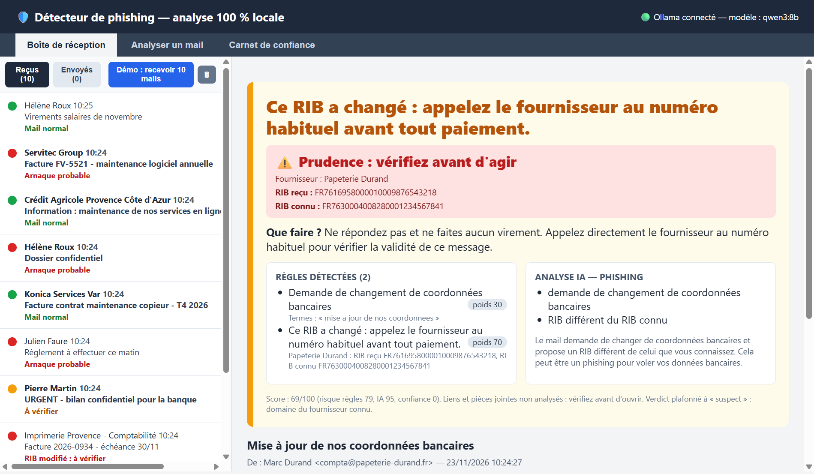
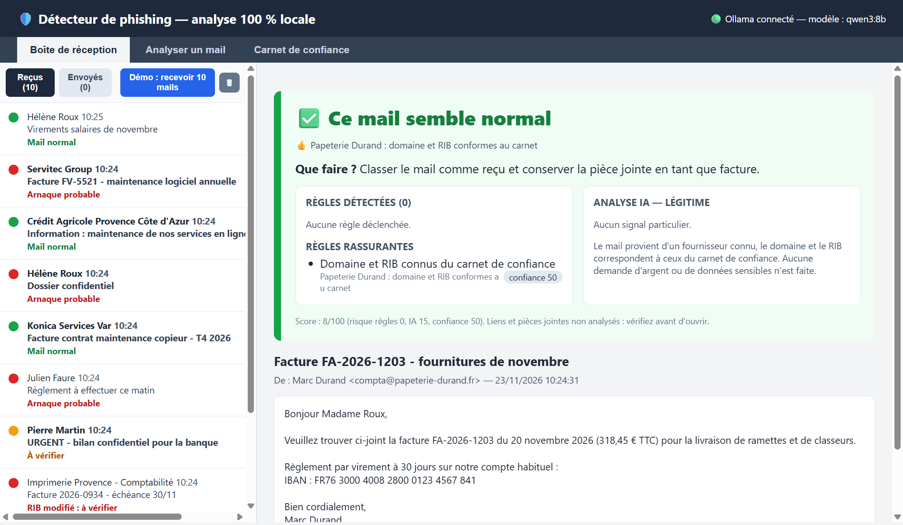
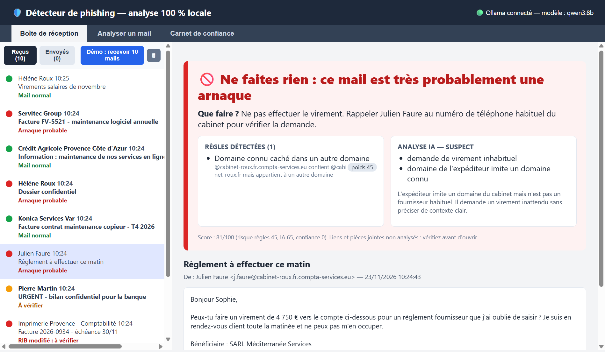
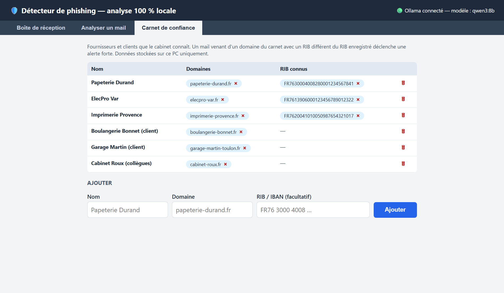

# 🛡️ Détecteur de phishing pour TPE — fraude au virement

Prototype d'application de bureau (Electron) qui analyse les mails reçus par un cabinet comptable et signale les tentatives de **fraude au virement** : faux changement de RIB, faux « président », fausses factures. L'analyse est **100 % locale** : l'IA tourne sur la machine via [Ollama](https://ollama.com), et l'application bloque toute requête réseau hors `127.0.0.1`. Aucun mail ne quitte le poste.

> Prototype réalisé pour le projet « Startup IA en 4 heures » (Lab IA, ISEN Méditerranée). Ce n'est pas un produit de sécurité prêt pour la production : voir [Limites](#limites).

## Fonctionnement

Le score est **hybride** : des règles déterministes et un LLM local sont combinés.

- **Règles** (`regles.js`) : IBAN étranger, néobanque, domaine différent du nom affiché, domaine imité (typosquatting), domaine connu caché dans un autre (`cabinet-roux.fr.partage-docs.net`), mots d'urgence / confidentialité, refus de confirmer par téléphone, demande de changement de RIB.
- **Carnet de confiance** (`carnet.js`) : domaines et RIB connus par fournisseur. Un RIB différent du RIB connu déclenche une alerte forte ; domaine **et** RIB connus font baisser le score. Un RIB changé depuis le vrai domaine d'un fournisseur est plafonné à « suspect » (changement de banque possible, mais à vérifier par téléphone).
- **LLM local** (`analyse.js`) : `qwen3:8b` via Ollama, réponse JSON imposée. Le programme lui fournit des faits calculés (messagerie gratuite, domaine connu, RIB conforme ou non) pour limiter les inventions.
- **Formule** : `risque = IA + (100 − IA) × règles / 100`, puis `final = risque × (1 − confiance / 100)`. Verdict : ≥ 70 phishing, 35 à 69 suspect, < 35 légitime.
- **Boîte de réception simulée** (`boite.js`) : fichier JSON local, analyse automatique en tâche de fond, démo de 10 mails, réponses écrites dans un dossier « Envoyes » local (rien n'est envoyé).

## Captures

| Faux changement de RIB | Mail légitime d'un fournisseur connu |
|---|---|
|  |  |

| Domaine caché dans un autre | Carnet de confiance |
|---|---|
|  |  |

## Prérequis

- [Node.js](https://nodejs.org) 20 ou plus (testé avec Node 24).
- [Ollama](https://ollama.com) installé, avec le modèle :
  ```bash
  ollama pull qwen3:8b
  ```
  (environ 5 Go ; un GPU facilite, mais ce n'est pas obligatoire). Si Ollama n'est pas lancé, l'application tente de le démarrer (`ollama serve`).

## Installation et utilisation

```bash
npm install     # installe Electron
npm start       # lance l'application
npm test        # 10 mails de test : tableau attendu / obtenu / score (nécessite Ollama)
```

Dans l'application : onglet **Boîte de réception** → bouton « Démo : recevoir 10 mails » (mails tirés de `mails-aveugles-2/`, à garder à côté de l'application) ; onglet **Analyser un mail** pour coller un mail ; onglet **Carnet de confiance** pour gérer fournisseurs, domaines et RIB. Le carnet est initialisé avec `carnet-demo.json`.

Test aveugle sur un lot de mails : `node test-aveugle.js mails-aveugles-2 --detail` (nom de fichier = verdict attendu : `phishing__…`, `suspect__…`, `legitime__…`).

## Résultats des tests (à lire avec prudence)

- Lot 2 (16 mails aveugles, écrits par un sous-agent sans accès au code, lancé une seule fois) : **12/16** ; 8 phishing sur 8 signalés (phishing ou suspect), 0 faux « phishing » sur les 6 légitimes. Résultats bruts : `resultats-mails-aveugles-2.json`.
- Lot 1 (`mails-aveugles/`) : **biaisé**, car les règles ont été corrigées en regardant ses échecs. Avant corrections : 8/16 (`resultats-aveugles.json`) ; après : 9/16 (`resultats-mails-aveugles.json`).
- Ces scores viennent de 16 mails fictifs par lot : ils illustrent le comportement, ils ne mesurent pas une fiabilité réelle.

## Limites

- **Périmètre** : fraude au virement uniquement. Le vol d'identifiants par lien (faux SharePoint, faux DocuSign) n'est volontairement pas traité.
- **Ni liens ni pièces jointes ne sont analysés** : l'outil dit « vérifiez avant d'ouvrir ».
- **Pas de vérification technique de l'expéditeur** (SPF, DKIM, DMARC) : on ne voit que l'adresse collée. Un compte fournisseur piraté qui renvoie son vrai RIB n'est pas détectable.
- **Un faux changement de RIB et un vrai** reçoivent le même verdict « suspect » depuis le vrai domaine : la vérification par téléphone reste indispensable.
- **LLM de 8 milliards de paramètres** : verdicts non parfaitement stables d'une exécution à l'autre, parfois trop méfiants (clients qui écrivent « urgent »), parfois rassurés à tort sans demande de RIB (faux notaire classé « suspect »).
- **Poids des règles et seuils** : estimés à la main, non calibrés sur des données réelles.
- Les codes banque français de Revolut et Wise dans `regles.js` n'ont pas été vérifiés.
- Données de test **entièrement fictives** (noms, entreprises, mails, IBAN, numéros de téléphone) ; toute ressemblance avec un cas réel serait fortuite.
- Pas de gestion de vraie messagerie (IMAP/Outlook) : la boîte est simulée.
